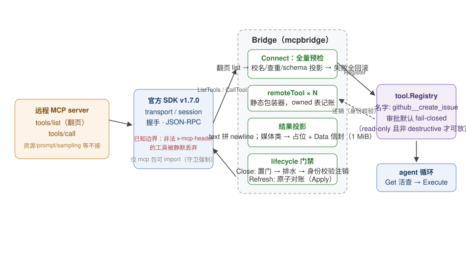

# MCP 桥设计文档

> 对象读者：想理解或修改 `mcp/`（package `mcpbridge`）实现的人。
> 绑定契约是 `mcp/README.md`；本文解释契约背后的设计与实现。

## 1. 一句话定位

`mcp` 桥把**远程 MCP server 的工具**接进本项目的 `tool.Registry`：调用方自备官方 SDK 的 transport，`Connect` 一次性发现全部远程工具并在注册表里创建静态包装器，此后 agent 循环把远程工具当本地工具用。它是全仓库**唯一允许 import MCP SDK 的包**（`scripts/kernel-closure-guard.sh` 强制），SDK 因此只存在于用到它的二进制里。

## 2. 协议面分层：先讲清 MCP 里谁负责什么

MCP 协议很宽，本桥只做 tools 行。按"谁负责"分三层：

| 层 | 内容 | 归属 |
|----|------|------|
| 传输与会话 | stdio / HTTP transport、握手、JSON-RPC 帧 | **官方 SDK 100% 负责**，本桥零设计依赖 |
| tools 行 | 工具发现（list）、参数 schema（inputSchema）、调用（call）、结果内容（text/image/audio/resource_link/embedded） | **本桥逐字段覆盖**，覆盖不到的显式文档化 |
| 非 tools 能力 | resources、prompts、sampling、elicitation、logging、roots | **v1 冻结不做**（见 §7） |

tools 行内部也有覆盖边界，均源自 SDK 解码的上游限制，不是本桥偷懒：

- schema 经 SDK 的 `map[string]any` 解码后**丢失重复键、出现顺序、精确数字字面量**——上游就没了，本桥的语义保真编解码器只能保住解码后剩下的；
- SDK v1.7.0 的 `ListTools` 会**静默丢弃**带非法 `x-mcp-header` 注解的工具，本桥观察不到也拒绝不了，只能文档化让 server 作者修；
- `_meta`、`OutputSchema`、Title/Icons、内容级 annotations、progress 通知是**有意丢弃**（YAGNI，v1 冻结）。

## 3. 架构总览



一次调用的完整路径：

```
模型决定调 "github__create_issue"
  → agent 循环 Registry.Get("github__create_issue") 得到 remoteTool
  → remoteTool.Execute: 走 closing 门禁 → 经 session 调远程 CallTool
  → 结果内容投影：text 拼 newline；image/audio/resource_link 生成
    转义占位 Content + 索引化 JSON Data 信封（累计 1 MiB 预算）
  → ToolResult 回到循环，Data 仅当次运行可见
```

命名规则：`{namespace}__{remoteName}`，namespace 匹配 `^[A-Za-z0-9_-]{1,64}$` 且不含 `__`。双下划线保留为分隔符是唯一防碰撞手段（远程名本身可能含下划线）。

## 4. 接口设计

### 4.1 Connect（bridge.go:24）

```go
func Connect(ctx, registry, transport, cfg, opts...) (*Bridge, error)
```

预条件三条：registry 非 nil、transport 非 nil、namespace 合法。语义要点：

- **静态发现**：翻页拉全 `ListTools`，每个远程工具包一个 `remoteTool` 静态注册。不自动订阅 list-changed——对账靠手动 `Refresh`。
- **失败回滚**：Connect 中途任何一步失败，`defer` 里把已注册的名字全部注销、关闭 session——**半接状态不存在**。
- **注册前全量预检**：`prepareTools` 先对每个远程名做最终名校验、重名检查（与 seen 集合、与 registry 现有名字）、schema 投影，任何错误汇成排序错误列表一次性返回。先预检后注册，避免"注册了 80 个、第 81 个失败再回滚"。
- `MultiRoundTrip` 强制 Disabled：input-required 结果投影为一条软错误 `v1 不支持 MCP input-required continuation`，不重试。

### 4.2 选项（options.go）

- `WithApprovalRequired`：**默认 true（fail-closed）**。设为 false 只放宽"annotations 明确 read-only 且不 destructive"的工具，其余仍然全部要审批——宽松是被动的、收紧是默认的。
- `WithResultDataLimit`：Data 信封累计预算，默认 1 MiB；Connect 时拒绝非正值；逐条检查**累计**编码后的大小，超限条目变成 `"[mcp:<type> omitted: ...]"` 占位文本而非错误。

### 4.3 Refresh（手动对账）

`Refresh(ctx)` 重新 list 并经 `Registry.Apply` **原子**对账桥所拥有的集合：拉取或应用失败则注册表与 owned 表都保持原样（全部成功或全部不动）。名字按前缀管辖——前缀下不属于本桥的名字不碰，进 Refresh 摘要的 conflict 列表。**未 Refresh 的窗口内，远程已删除的工具调用会产生硬协议错误**——这是静态发现的已知代价，换来的是无后台协程、无订阅、可预测。

`Refresh` 与 `Close` 需要**调用方串行化**，桥内部不设互斥（文档化而非代码强制，因为两者都要求外部 quiescent 前提）。

### 4.4 Close（优雅排水）

三步序：先原子置 `closing` 门（新 Execute 立即软失败）→ 等写锁（等所有已准入的 in-flight Execute 释放读锁）→ 注销仍拥有的名字（指针身份校验）并关 session。lifecycle 的双机制（atomic.Bool + RWMutex）就是为此：门禁发布要即时，排水要等真实完成。挂死的远程调用会拖延 Close——打破手段是取消那个调用的 ctx，桥不替你兜底。

身份校验的细节：注销前 `registry.Get(name)` 与自己的 wrapper **指针比较**，用户用 `Replace` 顶掉的名字不算拥有了，留在原地。运行中途移除桥对正在跑的 run 是安全的：已规划该工具的 run 要么拿到 in-flight 结果，要么拿到门禁软错误，绝不会因关停本身得到 session 级硬错误。

### 4.5 Manager（多 server 记账）

Manager 管多个 Bridge 共用一个 registry：按 `serverID` Connect/Disconnect/Refresh、`Snapshot` 出每 server 清单、`OwnerOf(toolName)` 做故障归因。所有权**每次活查**（不缓存），所以 Replace 与 Refresh 立刻反映到下一次查询。它是纯记账层：registry 本身不知道工具从哪来。

## 5. 关键实现机制

### 5.1 schema 投影（schema.go）

远程 inputSchema 是 SDK 解出的 `map[string]any`，本桥将其重新投影为 `tool.ParameterSchema`——走 `UnmarshalJSON` 的语义保真路径，类型化词汇 + 关键词载体（名字排序）。保真上限受 §2 所述 SDK 解码边界约束。注意：**schema 可表示 ≠ provider 接受**，这是两件独立的事，投影成功不承诺每个 provider 都吃下这个 schema。

### 5.2 结果投影（result.go）

MCP 内容数组 → ToolResult 的映射：

| 内容类型 | 处理 |
|----------|------|
| text | 多段以 `\n` 连接进 Content |
| image / audio / resource_link / embedded resource | Content 放转义后的类型占位符，原始载荷进索引化 Data 信封 |
| 超预算条目 | 占位文本 `"[mcp:<type> omitted: ...]"`，不是错误 |

软/硬分界：**mapper 失败（结果整形）是软的**（模型可恢复），**协议/传输错误是硬的**（循环该知道远程坏了）。桥内零重试——重试语义归上层。

## 6. 失败模型

| 失败 | 层级 | 表现 |
|------|------|------|
| Connect 预条件失败 / list 失败 / 预检有错 | 硬 | Connect 报错，已注册部分全部回滚 |
| input-required 结果 | 软 | 固定文案软错误，不重试 |
| Data 超预算 | 软 | 占位文本，内容裁剪 |
| closing 门后的 Execute | 软 | 立即软失败 |
| 远程调用协议/传输错误 | 硬 | Go error 中断循环 |
| Refresh 部分失败 | — | 原子放弃，两边状态不变 |

## 7. 非目标（v1 冻结）

agent/server 模式；resources/prompts/sampling/roots/logging/elicitation；OAuth 策略、自动安装、网络发现；自动订阅 list-changed / 自动对账；桥内重试、重连、每工具超时、共享 session；root README 与 examples。

## 8. 测试策略

- SDK 钉死 v1.7.0（kernel-closure-guard 字节级校验），所有测试在钉死版本上写。
- 进程内 stdio transport 示例测试（`stdio_example_test.go`）不依赖网络即可覆盖 Connect→Execute 全链。
- Close 排水、Refresh 原子性、身份校验跳过 Replace 名字等并发契约用 `-race` 覆盖。
- 覆盖边界类行为（非法 x-mcp-header 被静默丢弃）只做**文档化断言现状**，不承诺修复上游。
