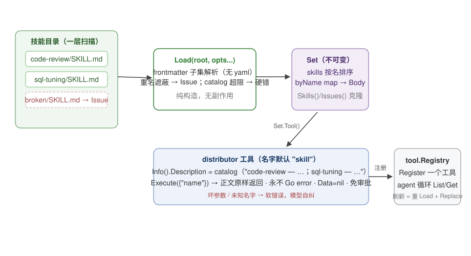

# Skills 设计文档

> 对象读者：想理解或修改 `skills/` 包实现的人。绑定契约是 `skills/README.md`。

## 1. 一句话定位

`skills` 把一个**技能目录**（一层子目录，每目录一份 SKILL.md）加载成一个不可变的 `Set`，并把整个集合暴露为**一个分发器工具（distributor tool）**：工具的 Description 携带目录清单（名字 + 描述），Execute 按名字原样返回某份技能正文。只依赖 stdlib + `tool` 包，对内核 diff 为零。

## 2. 核心概念：distributor 模式，用一个场景讲清楚

假设技能目录里有 `code-review/` 和 `sql-tuning/` 两个技能，agent 运行时发生的事：

```
装配期（run 之前，一次性）:
  Load("./skills/") → 扫描一层子目录 → 解析两份 SKILL.md → 不可变 Set
  registry.Register(set.Tool())        ← 整个集合只注册一个工具

运行期:
  1. 模型收到的工具声明里有一项:
       name: "skill"
       description: "可用技能：code-review — 审查代码变更…；sql-tuning — 优化慢查询…"
                        ↑ 这就是 catalog，目录清单长在 Description 里
  2. 模型决定"先看看 code-review 怎么做"，调用 skill({"name": "code-review"})
  3. distributor.Execute 在内存 map 里查到正文，原样返回 markdown
  4. 模型把正文读进上下文，按其中的方法论行事
```

这就是 Anthropic Agent Skills 的"渐进式披露"（progressive disclosure）在本项目的最小实现：**目录清单常驻上下文（便宜），正文按需加载（贵但选择性）**。裁剪掉的部分见 §7。

对比另一种设计——每个技能注册成独立工具——distributor 的优势：工具数量不膨胀模型声明（每个工具声明都有 token 成本），且技能集合变化只影响一个工具的 Description。代价是模型要多走一轮工具调用才能拿到正文。

## 3. 架构总览



## 4. 接口设计

### 4.1 Load（skills.go:72）

```go
func Load(root string, opts ...Option) (*Set, error)
```

两个选项：

- `WithToolName`：分发器工具名，默认 `"skill"`，须匹配 `^[A-Za-z0-9_-]{1,64}$`。
- `WithCatalogLimit`：catalog 总 rune 预算，默认 2048（约容纳 10-12 个"名字 + 120 rune 描述"的条目）。

`Set` 是不可变的：`Skills()`/`Issues()` 返回排序后的克隆，没有任何修改 API。**刷新 = 重新 Load + 宿主用 `registry.Replace` 换血**——包内不做 watcher。不可变的理由：分发器的 Info()（含 catalog）会被并发反复调用，可变集合要么加锁要么快照，两者都比"每次 Load 造一个新值"贵且复杂。

### 4.2 Skill / Issue

`Skill{Name, Description, Body, Dir}`：Name 取 frontmatter 的 name，缺省用子目录名；Description 空白折叠、超 1024 rune 截断加省略号（截断记 Issue）；Body 是 frontmatter 之后修剪过的原文。

`Issue{Dir, Skill, Problem}`：**跳过或截断的记录**。被重名遮蔽、frontmatter 非法、描述截断——全部进 Issues，不中断 Load。宿主应把 Issues 打进日志：一条被静默吞掉的 Issue 就是一个模型永远发现不了的技能。

### 4.3 Set.Tool()（distributor.go）

分发器参数 schema 就一个 `name: string`（required）。Execute 的全部逻辑：

- args 不是 `{"name": string}` → 软错误 `invalid arguments`；
- 名字不在集合 → 软错误 `skill %q not found`；
- 命中 → `NewTextResult(Body)`，Data 恒 nil，**永不返回 Go error**。

所有失败都是软的且文案面向模型自纠（"重新读 catalog 换个名字重试"），运行永不因分发器而中断。`RequiresApproval` 固定 false：读一份本地 markdown 没有副作用，审批是纯开销。

## 5. 关键实现机制

### 5.1 扫描（scan.go）

- 只扫**一层**子目录（`os.ReadDir` 天然名字排序——重名碰撞时排序在前的目录胜出，败者记 Issue）；
- 每份 SKILL.md 用 1 MiB `io.LimitReader` 封顶读；
- **目录符号链接不跟随**（lstat 判断 IsDir）——防环、防越界。

### 5.2 frontmatter 子集解析（parse.go）

手写的平面 `key: value` 解析器，只认 `name`、`description` 两个键。**明确不用 yaml**：两个纯文本字段配一个 yaml 依赖，是给内核零依赖原则上撒盐；且 yaml 的多行块标量、锚点、别名对一个技能描述毫无意义。解析规则：

- 剥 BOM、CRLF 归一为 LF；
- 缺围栏（`---` 行）、重复键、`|`/`>` 块标量、格式坏行、正文为空——任一即**该技能非法**，跳过记 Issue；
- description 必填。

### 5.3 catalog 组装与预算（catalog.go）

catalog = 头部 + 按名字排序的条目。总 rune 数超 `WithCatalogLimit` 是 **Load 硬错误**，错误信息带条目数、限额与解法（裁技能或调大限额）。为什么不静默截断？**被截掉的条目是一个模型永久发现不了的技能**——目录清单的存在意义就是完整性，宁可在装配期炸出来。

一个已知的真实约束：catalog 在 Description 里，而内核的截断/预算只按历史 rune 计——**Description token 不进内核的账**。所以预算由本包自己守（2048 默认），宿主别把它调到离谱。

### 5.4 失败分层（与 mcp 对比）

| | skills.Load | mcp.Connect |
|---|---|---|
| 硬失败 | 仅边界：root 读不了、选项非法、catalog 超限 | 预检任何错误，全部回滚 |
| 软/跳过 | 单技能非法 → Issue 收集，继续 | 无（要么全成要么不成） |
| 副作用 | 无（纯构造新值） | 写 registry，失败须回滚 |

skills 天然无副作用（Load 不写共享状态），所以可以"宽容收集"；mcp 有副作用（注册表写入），所以必须 fail-closed-rollback。失败策略跟着副作用形状走，不是品味差异。

### 5.5 刷新的两层语义

刷新 = 重新 Load + 宿主 `registry.Replace`。因为执行是**每次 Get 活查**（tool 包语义），替换后的 run 立即用新集合；但**广播层**（模型手里的工具声明）按配置不同：默认 run 开始时快照，`WithDynamicTools` 时每次迭代重发。中途 Replace 后，模型按旧 catalog 调已被换掉的名字会拿到分发器的软错误——良性，模型可自纠。

### 5.6 第三层文件

SKILL.md 正文里引用的附带文件（脚本、模板）不在本包职责内：宿主应把技能目录放在 harness 工作区根内，让宿主的文件工具按正文里的相对路径去读。包本身对 root 位置无假设。

## 6. 失败模型

| 失败 | 层级 | 表现 |
|------|------|------|
| root 不可读 / 选项非法 / catalog 超限 | 硬 | Load 返回错误 |
| 单技能 frontmatter 非法 / 重名 / 描述超长 | 软 | 跳过 + Issue |
| 分发器 args 坏 / 名字不存在 | 软 | `NewErrorResult` 喂回模型 |
| Execute 其他一切异常 | — | 不存在：纯内存读，无 Go error 路径 |

## 7. 非目标（v1 冻结）

allowed-tools 权限裁剪、slash-command 展开、watcher/Refresh API、marketplace、嵌套扫描、附属文件打包加载、完整 yaml、审批选项。

## 8. 测试策略

- 解析器用表驱动穷举 §5.2 的非法形态，每个用例断言"跳过 + 对应 Issue 文案"。
- 碰撞规则断言"排序在前的目录胜出 + 败者入 Issue"。
- catalog 预算断言硬错误的错误信息包含计数、限额、 remedy。
- 分发器断言软错误路径零 Go error、Data 恒 nil、Info 幂等（catalog 稳定）。
- 符号链接不跟随：临时目录建 dir symlink，断言被跳过。
