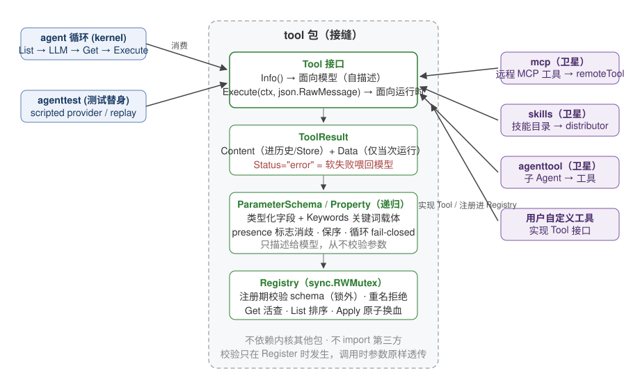

# Tool 设计文档

> 对象读者：想理解或修改 `tool/` 包实现的人。API 速查见 godoc；整体架构见 `docs/DESIGN.md`。
> 本文引用的行号以撰写时的代码为准，结构性重构后需复核。

## 1. 一句话定位

`tool` 是内核中的**工具接缝（seam）**：定义"一个工具是什么"（`Tool` 接口）、"工具如何向模型描述自己"（`ToolInfo` + `ParameterSchema`）、"工具结果如何回到循环"（软失败 `ToolResult`），以及线程安全的注册表 `Registry`。内核的 agent 循环、MCP 桥、技能分发器、agent-as-tool 全部站在这个接缝上，彼此不直接认识。

## 2. 核心概念：用一个端到端场景讲清楚

假设用户问 agent "北京现在多少度"，agent 决定调用 weather 工具：

```
用户消息 ──► agent 循环 (agent/)
              │ 1. 从 Registry.List() 拿到所有 ToolInfo
              │    [weather: "查天气", 参数 {city: string}]
              │ 2. 把 ToolInfo 序列化成 JSON Schema 发给 LLM
              ▼
           LLM 回复："我要调 weather(city=北京)"
              │ 3. 循环按名字 Registry.Get("weather") 拿到 Tool
              │ 4. 调 Execute(ctx, `{"city":"北京"}`)   ← args 是原始 JSON，原样透传
              ▼
           ToolResult{Content:"北京 23℃"}
              │ 5. 循环把 Content 作为工具结果消息追加进历史，继续下一轮
```

三个贯穿全文的机制在这个场景里已经出现：

- **schema 只描述、不校验**：第 2 步的 `ParameterSchema` 是给模型看的说明书，不是参数校验器。模型第 4 步发来的 args 原样透传给 `Execute`，本仓库内没有任何地方拿 schema 校验参数（校验只发生在 `Registry.Register` 时，针对 schema 自身结构）。
- **软失败**：假如模型传了 `{"city": 123}`，weather 工具应返回 `ToolResult{Status:"error", Content:"city must be a string"}`——这个错误会被喂回给模型，模型可以改参数重试，运行不中断。Go error 只留给"循环本身无法继续"的系统级故障（网络断、panic 恢复）。
- **运行中可变**：第 3 步的 `Get` 与 agent 循环并发，`Registry` 用 `RWMutex` 保证工具可以在一次运行中途被注册/注销（MCP 桥的动态接入正依赖这一点）。

## 3. 架构总览



要点：

- `tool` 包不 import 内核其他包，也不被 llm/、store/ 认识；它只被上游消费（agent 循环）和下游实现（各卫星）。
- `ParameterSchema` 是一个**递归类型模型**而非 `map[string]any`：类型化字段（`Type`/`Properties`/`Items`/`AnyOf`…）+ `Keywords` 关键词载体，两者组合表达任意 JSON Schema。这是"语义保真"编解码器的基础，见 §5.2。

## 4. 接口设计

### 4.1 Tool（tool.go:14）

```go
type Tool interface {
    Info() ToolInfo
    Execute(ctx context.Context, args json.RawMessage) (*ToolResult, error)
}
```

两面性是这个接口的全部设计：

- `Info()` 面向**模型**：名字、描述、参数 schema，直接映射为 provider 的 function-calling 声明。
- `Execute()` 面向**运行时**：接收模型产出的原始 JSON args，返回结果。

`args` 用 `json.RawMessage` 而不是 `map[string]any` 或泛型：反序列化是每个工具自己的事，接缝不承担类型系统的翻译成本，也不丢失字段顺序、重复键等原始信息。

`Info()` 会被 `Registry.List()` 在持锁路径之外反复调用（见 §5.1），因此实现必须**纯读、无副作用、幂等**——这是接口的隐含契约。

### 4.2 ToolInfo 与 RequiresApproval（tool.go:33)

`ToolInfo` 四个字段中唯一有行为语义的是 `RequiresApproval`：为 true 时，agent 循环在执行前必须走审批回调；**没有配置审批回调时 fail-closed——工具被拒绝执行，而不是默认放行**。这是全项目审批语义的锚点，MCP 桥的"默认全部需要审批"只是在这个锚点之上叠加的策略。

### 4.3 ToolResult：软失败契约（tool.go:93）

```go
type ToolResult struct {
    Content string          // 必有：文本内容，进历史、进 Store
    Data    json.RawMessage // 可选：结构化数据，仅供当次运行的消费者
    Status  ResultStatus    // "" = 成功，"error" = 软失败
}
```

构造函数三件套：`NewTextResult`（纯文本）、`NewDataResult`（文本 + 结构化）、`NewErrorResult`（软失败，**唯一**合法的错误结果构造方式——禁止手写 Status 字符串）。

`Data` 的边界要特别注意：它只对**当次运行的 `ToolResultEvent` 消费者**可见；历史快照（`DoneEvent.History`）和 Store 持久化只保留 `Content`。设计动机是结构化数据可能很大（MCP 的 1 MiB 信封就放在这里），不应膨胀持久化日志。

### 4.4 Registry（registry.go:10）

| 方法 | 语义 |
|------|------|
| `Register(t)` | 先在锁外跑 `validateForRegistration`（校验 schema 结构），再拿写锁；重名报错 |
| `MustRegister(t)` | Register 的 panic 版，用于"失败即程序错误"的装配场景 |
| `Get(name)` | 读锁点查 |
| `List()` | 读锁收集全部 `Info()`，按名字排序返回（排序保证输出确定性，测试与模型声明都依赖） |
| `Unregister(name)` | 幂等注销；不等待 in-flight Execute，不回写历史 |
| `Apply(...)` | 原子批量换血，MCP Refresh 的对账基础 |

设计决策：**校验在锁外**。用户实现的 `Info()` 不可信（可能慢、可能 panic），绝不在持 `RWMutex` 期间调用它；校验完成后才进临界区做纯 map 操作。

`Get` 返回 `(Tool, bool)` 而不是缓存的副本：**每次执行都是对工具句柄的活查询**。这意味着运行中途 `Replace`/`Unregister` 一个工具，后续调用会立刻看到新工具或软失败——这是 skills/mcp 热更新的执行层语义。

### 4.5 ParameterSchema / Property（tool.go:49 / :66）

递归 JSON Schema 的 Go 模型：

- `Property` 是递归节点：`Items *Property`、`Properties map[string]Property`、`AnyOf/OneOf/AllOf []*Property`、`Ref`。
- `SchemaKeyword{Name, Value}` 携带**没有类型化表示的 JSON Schema 关键词**（如 `format`、`minimum`），Value 是一段合法 JSON。
- 未导出的 presence 标志（`typeAbsent`、`propertiesInactive`、`refPresent`…）区分"字段为零值"与"字段未出现"——`type: ""` 和 `type` 缺失对模型是两个不同的 schema，编解码器必须保住这个区别。

## 5. 关键实现机制

### 5.1 Registry 并发模型

```
写路径 Register/Unregister/Apply ──► mu.Lock（临界区内只有 map 操作）
读路径 Get/List               ──► mu.RLock（List 在锁内收集，排序在锁外也行——实现选择在锁外排序）
```

`sync.RWMutex` 而非 `sync.Map`：注册表小（几十个工具）、读写比不极端，RWMutex 语义清晰且允许 Apply 做复合原子操作，sync.Map 做不到。

与 agent 循环的协作约定：循环在迭代开始时 `List()` 快照工具声明发给模型；执行时 `Get()` 活查。两次查询之间注册表可能已变——变了的后果被刻意设计为良性的：Get 不到 → 软失败喂回模型。

### 5.2 语义保真编解码器（schema_marshal.go / schema_unmarshal.go）

这个编解码器解决的问题是：**JSON Schema 经过 Go 结构体往返一次后，模型看到的东西必须与原始 schema 语义等价**。三个具体手段：

1. **presence 标志**：unmarshal 时记录每个字段的"出现/未出现"，marshal 时按标志决定输出，零值歧义被消除。
2. **有序关键词载体**：`Keywords` 保留关键词的**出现顺序**。顺序本身是 fidelity 的一部分（同名关键词后者覆盖前者，顺序丢失会导致语义翻转）。
3. **循环检测**：`$ref` 指向的递归结构（链表、树型 schema）会让朴素的 `encoding/json` 栈溢出或死循环。marshal/unmarshal 共享一个 active-stack 检测器，检测到环即报错——**fail closed，绝不挂起**。这对自定义 `MarshalJSON` 尤其重要：标准库对自定义 marshaler 没有任何循环保护。

null 归一化采用 null-first 策略：显式 `null` 与字段缺失在 unmarshal 入口就被区分处理。

外部构造语义统一为：指针非 nil = 出现、`Ref` 非空 = 出现、空 `Ref` = 缺失——对所有可外部构造的值用同一套规则，不搞特例。

### 5.3 注册期校验（schema_validate.go）

校验只发生在 `Registry.Register` 时，检查内容：schema 结构合法、组合子（anyOf/oneOf/allOf）无循环。**校验参数这件事在仓库里不存在**——模型发来的 args 越过 schema 直达 `Execute`，由工具自己解析并软失败。为什么不校验？三个理由：

- 模型的 args 本来就会在解析失败时以软失败喂回，模型自纠成本低；
- 仓库内维护一个 JSON Schema 校验器是巨大的第三方面积，与内核零依赖冲突；
- 校验器误杀合法参数的风险比放过非法参数的成本高（后者可恢复，前者不可）。

## 6. 失败模型

| 失败 | 层级 | 表现 |
|------|------|------|
| 工具入参不合法 / 资源不存在 | 软 | `ToolResult{Status:"error"}` 喂回模型，循环继续 |
| 结果 Data marshal 失败 | 软/硬边界 | `NewDataResult` 在构造时返回 Go error（调用方决定） |
| schema 循环 / 结构非法 | 硬 | `Register` 返回错误，工具进不了注册表 |
| 注册重名 | 硬 | `Register` 报错；`Apply` 用重复检查兜住命名空间冲突 |
| 工具实现 panic / 系统故障 | 硬 | Go error 中断 agent 循环（属循环的职责，不在本包） |

## 7. 非目标

- **不做参数校验执行**（§5.3 的理由）。
- **不做工具版本化 / 元数据演化**：重名即拒绝，不提供灰度替换原语（Replace 的语义由上游定义）。
- **不感知 provider 差异**：schema 到各 provider wire format 的适配在 llm/ 各 adapter 内完成，本包只输出标准 JSON Schema 形状。
- **不做超时 / 重试 / 断路器**：Execute 的运行时治理归调用方（agent 循环）或工具实现。

## 8. 测试策略

- 表驱动、stdlib `testing`、white-box in-package（全项目统一约定）。
- schema codec 的测试核心是**往返保真**：构造带 presence 歧义、关键词顺序、`$ref` 循环的用例，断言 unmarshal→marshal 后与语义等价而非字节等价；循环用例断言返回错误而非超时。
- Registry 并发用 `-race -shuffle=on`（CI 命令见根 AGENTS.md）覆盖 Register 与 Get/List 竞态。
- 下游卫星（mcp/skills/agenttest）从消费侧反向覆盖接缝契约：软失败喂回、List 排序稳定性、Replace 后 Get 活查语义。
